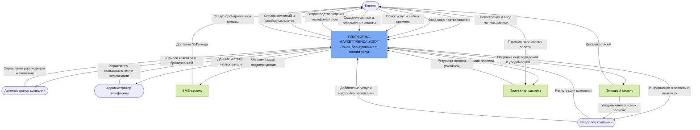
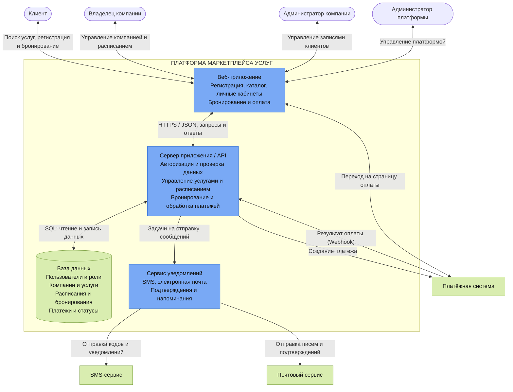

ELEVATOR PITCH  
Людям сложно быстро найти подходящую услугу на нужное время, а записи разбросаны по разным сервисам. Мы создаём единый маркетплейс услуг с умным поиском по свободному времени и единым календарём записей. В отличие от обычных карт и сервисов записи, мы объединяем поиск, бронирование и все записи пользователя в одном месте, а бизнесу помогаем привлекать новых клиентов. В результате пользователи экономят время, а малый бизнес получает дополнительный канал привлечения клиентов. Сейчас мы ищем первые компании для подключения — хотите посмотреть MVP?

LEAN CANVAS


РИСКИ  
1. Компании не захотят подключаться к платформе(Критический)
У бизнеса уже есть свои способы привлечения клиентов, например Яндекс Карты, соцсети и собственные сайты. Компании могут не увидеть смысла в подключении к новой площадке.

2. Компании не будут поддерживать актуальность расписания
Если свободные слоты не обновляются вовремя, пользователь может записаться на уже занятое время.

3. Экономика привлечения клиентов не сойдётся
Расходы на рекламу и привлечение пользователей могут оказаться выше комиссий, которые платформа получает с их записей.

4. Слишком высокая конкуренция
Существующие сервисы могут уже закрывать потребности пользователей и бизнеса, а у нового проекта не будет достаточного преимущества.

5. Компании не захотят платить за сервис
Бизнес может согласиться размещаться на платформе бесплатно, но отказаться от комиссии за записи, продвижения и платной подписки.

HADI(риск 1)  

H: Не менее 30% заинтересованных в привлечении клиентов компаний согласятся протестировать сервис.

A: Связаться с 30 компаниями в одном городе: барбершопами, салонами красоты и тд. Показать концепцию сервиса, собрать обратную связь и предложить бесплатный пилот.

D: Зафиксировать число ответивших компаний, согласившихся на пилот и реально разместивших услуги. Основная метрика — доля компаний, согласившихся на тестирование.

I: Если гипотеза подтверждается, подключаем первые компании и проверяем спрос на услуги. Если нет — выясняем причины отказов и пересматриваем предложение.

ЮНИТ-ЭКОНОМИКА  
Рекламный бюджет:	30 000 ₽  
Стоимость перехода на сайт:	35 ₽  
Количество переходов:	857  
Конверсия в первую запись:	7%  
Количество новых клиентов:	60  
CAC: 500 р  

Средний чек услуги:	2 000 ₽  
Комиссия платформы:	5%  
Доход с одной записи:	100 ₽  
Частота записей:	3 раза в месяц  
Срок активности клиента:	6 месяцев  
Всего записей: 18  
LTV: 1 800 р  

Итого: LTV/CAC = 3.6  

ПЛАН Б  
Revenue Pivot - переход от комиссии 5% за каждую запись к ежемесячной подписке за сервис онлайн-записи.  
Customer Segment Pivot - переход от обслуживания преимущественно конечных пользователей маркетплейса к обслуживанию бизнеса  

Вместо того чтобы зарабатывать преимущественно на привлечении клиентов для компаний, предлагаем бизнесу инструмент для управления записями.  
Сервис позволит компаниям:  
- вести единое расписание мастеров;  
- показывать клиентам свободные временные слоты;  
- принимать онлайн-записи;  
- автоматически учитывать занятое время;  
- управлять записями и клиентской базой.  
Основное отличие: компания платит за полезный инструмент, даже если клиент пришёл не из маркетплейса.

LEAN CANVAS (ПЛАН Б)  
  

| Role | User Story | MoSCoW |
|:---:|:---:|:---:|
|Владелец бизнеса|Как владелец бизнеса, я хочу зарегистрироваться и создать профиль компании, чтобы начать пользоваться сервисом.|M|
|Владелец бизнеса|Как владелец бизнеса, я хочу добавлять, редактировать и отключать услуги, указывая цену и длительность, чтобы клиенты видели актуальную информацию.|M|
|Владелец бизнеса|Как владелец бизнеса, я хочу настраивать рабочие часы, перерывы, выходные и недоступные интервалы, чтобы расписание соответствовало реальной работе компании.|M|
|Владелец бизнеса|Как владелец бизнеса, я хочу получить публичную страницу онлайн-записи, чтобы клиенты могли самостоятельно ознакомиться с услугами компании.|M|
|Владелец бизнеса|Как владелец бизнеса, я хочу, чтобы занятый интервал автоматически блокировался, чтобы две записи не пересекались по времени.|M|
|Владелец бизнеса|Как владелец бизнеса, я хочу видеть контактные данные клиентов и историю их посещений, чтобы вести клиентскую базу.|M|
|Владелец бизнеса|Как владелец бизнеса, я хочу вести отдельное расписание для каждого мастера, чтобы управлять работой нескольких сотрудников.|S|
|Владелец бизнеса|Как владелец бизнеса, я хочу видеть статистику записей, отмен и загрузки расписания, чтобы оценивать работу компании.|S|
|Владелец бизнеса|Как владелец бизнеса, я хочу синхронизировать расписание с внешним календарём, чтобы видеть рабочие и личные события в одном месте.|C|
|Владелец бизнеса|Как владелец бизнеса, я хочу настраивать бонусы, скидки и программу лояльности, чтобы стимулировать повторные посещения.|W|
|Мастер/Сотрудник|Как сотрудник, я хочу просматривать свои записи.|M|
|Мастер/Сотрудник|Как сотрудник, я хочу добавлять заметки и метки к карточке клиента, чтобы учитывать его предпочтения и особенности обслуживания.|C|
|Пользователь|Как клиент, я хочу выбирать услугу и дату и видеть свободное время, чтобы подобрать удобный интервал для посещения.|M|
|Пользователь|Как клиент, я хочу записываться на свободное время онлайн, чтобы не звонить администратору.|M|
|Пользователь|Как клиент, я хочу получать подтверждение записи с датой, временем и информацией об услуге, чтобы не забыть детали посещения.|M|
|Пользователь|Как клиент, я хочу получать напоминание о предстоящем посещении, чтобы не забыть о записи.|S|
|Пользователь|Как клиент, я хочу самостоятельно переносить или отменять запись по ссылке, чтобы не обращаться к администратору.|S|
|Пользователь|Как постоянный клиент, я хочу повторно записываться на ранее выбранную услугу в несколько действий, чтобы экономить время.|C|
|Пользователь|Как клиент, я хочу оплачивать услугу онлайн при записи, чтобы заранее рассчитываться за посещение.|W|  

MVP  
1. Как владелец бизнеса, я хочу зарегистрироваться и создать профиль компании, чтобы начать пользоваться сервисом.

2. Как владелец бизнеса, я хочу добавлять, редактировать и отключать услуги, указывая цену и длительность, чтобы клиенты видели актуальную информацию.

3. Как владелец бизнеса, я хочу настраивать рабочие часы, перерывы, выходные и недоступные интервалы, чтобы расписание соответствовало реальной работе компании.

4. Как владелец бизнеса, я хочу получить публичную страницу онлайн-записи, чтобы клиенты могли самостоятельно ознакомиться с услугами компании.

5. Как клиент, я хочу выбирать услугу и дату и видеть свободное время, чтобы подобрать удобный интервал для посещения.

6. Как клиент, я хочу записываться на свободное время онлайн, чтобы не звонить администратору.

7. Как владелец бизнеса, я хочу, чтобы занятый интервал автоматически блокировался, чтобы две записи не пересекались по времени.

8. Как администратор, я хочу просматривать, создавать, переносить и отменять записи, чтобы управлять расписанием компании.

9. Как клиент, я хочу получать подтверждение записи с датой, временем и информацией об услуге, чтобы не забыть детали посещения.

10. Как владелец бизнеса, я хочу видеть контактные данные клиентов и историю их посещений, чтобы вести клиентскую базу.  

MLP  
1. Как владелец бизнеса, я хочу вести отдельное расписание для каждого мастера, чтобы управлять работой нескольких сотрудников.

2. Как клиент, я хочу получать напоминание о предстоящем посещении, чтобы не забыть о записи.

3. Как клиент, я хочу самостоятельно переносить или отменять запись по ссылке, чтобы не обращаться к администратору.

4. Как владелец бизнеса, я хочу добавлять заметки и метки к карточке клиента, чтобы учитывать его предпочтения и особенности обслуживания.

5. Как владелец бизнеса, я хочу видеть статистику записей, отмен и загрузки расписания, чтобы оценивать работу компании.

6. Как постоянный клиент, я хочу повторно записываться на ранее выбранную услугу в несколько действий, чтобы экономить время.

7. Как владелец бизнеса, я хочу синхронизировать расписание с внешним календарём, чтобы видеть рабочие и личные события в одном месте.

## Просмотр свободного времени

**User Story:** Как клиент, я хочу выбирать услугу и дату и видеть свободное время, чтобы подобрать удобный интервал для посещения.

### Функциональные требования

- Система должна показывать список активных услуг компании с названием, стоимостью и продолжительностью.
- Клиент должен иметь возможность выбрать услугу и дату посещения.
- Система должна рассчитывать свободное время с учётом рабочего графика, перерывов, выходных, недоступных интервалов и существующих записей.
- Система должна показывать только интервалы, в которые выбранная услуга помещается целиком.
- Доступные интервалы должны отображаться с учётом часового пояса компании.
- Если свободного времени нет, система должна сообщать об этом и позволять выбрать другую дату.
- Перед переходом к оформлению записи система должна повторно проверять доступность выбранного интервала.

### Нефункциональные требования

- При нагрузке до 100 одновременно работающих пользователей 95% запросов на получение свободных интервалов должны обрабатываться не более чем за 2 секунды.
- Изменение доступности после создания или отмены записи должно отображаться в поиске не позднее чем через 5 секунд.
- Интерфейс должен корректно работать на мобильных устройствах с шириной экрана от 360 пикселей и на настольных компьютерах.
- Система должна корректно учитывать часовой пояс компании и переходы на летнее или зимнее время, если они применяются в соответствующем регионе.
- Целевая доступность функции поиска должна составлять не менее 99,5% времени в месяц, за исключением согласованных периодов технического обслуживания.


## Онлайн-запись на услугу

**User Story:** Как клиент, я хочу записываться на свободное время онлайн, чтобы не звонить администратору.

### Функциональные требования

- Система должна предоставлять форму записи с выбранной услугой, датой, временем, именем клиента и контактными данными.
- Система должна проверять заполнение обязательных полей и корректность введённых данных перед созданием записи.
- Перед сохранением записи система должна проверить, что выбранный интервал всё ещё свободен.
- Создание записи и резервирование временного интервала должны выполняться как единая атомарная операция. Если интервал уже занят, запись не должна создаваться.
- Каждая запись должна иметь уникальный идентификатор, сведения о компании, клиенте, услуге, времени посещения и стоимости на момент бронирования.
- После успешного создания система должна присвоить записи статус «Подтверждена» и показать клиенту информацию о бронировании.
- После сохранения записи интервал должен стать недоступным для повторного бронирования и появиться в расписании компании.
- Если выбранное время уже занято, система должна сообщить об этом и предложить выбрать другой интервал.
- Система должна формировать подтверждение записи и отправлять его по доступному каналу связи. В первой версии подтверждение отправляется на электронную почту, если клиент её указал, и отображается на экране.

### Нефункциональные требования

- При нагрузке до 100 одновременно работающих пользователей 95% корректных запросов на создание записи должны завершаться не более чем за 3 секунды при отсутствии конфликтов бронирования.
- При одновременной попытке 100 пользователей забронировать один и тот же интервал должна создаваться ровно одна запись, а остальные запросы должны получать сообщение о недоступности времени.
- Повторная отправка одного и того же запроса из-за двойного нажатия или сетевого повтора не должна приводить к созданию дубликатов записей.
- Подтверждение можно показывать только после успешного сохранения записи. При ошибке сохранения система не должна сообщать об успешном бронировании.
- Передача данных должна выполняться по протоколу HTTPS. Управление записями должно быть доступно только авторизованным пользователям с соответствующими правами.
- Контактные данные клиента не должны быть доступны другим клиентам. Интерфейс должен отображать только сведения, необходимые для оформления записи.
- Целевая доступность функции бронирования должна составлять не менее 99,5% времени в месяц, за исключением согласованных периодов технического обслуживания.

## DDD — доменные зоны

Приложение разделено на 4 основные доменные зоны:

**1. Компании и услуги**
- Создание и редактирование профилей компаний.
- Добавление и управление услугами.
- Указание стоимости и продолжительности услуг.

**2. Расписание**
- Настройка рабочего времени компании.
- Просмотр свободных временных интервалов.
- Учёт занятых часов и перерывов.

**3. Бронирование**
- Создание записей клиентами.
- Проверка доступности выбранного времени.
- Отмена и подтверждение записей.

**4. Пользователи**
- Регистрация и авторизация.
- Управление профилями клиентов и компаний.
- Получение уведомлений о записях.

### Глоссарий

| Термин | Описание |
|---|---|
| Компания | Организация, предоставляющая услуги. |
| Услуга | Работа или процедура, доступная для заказа. |
| Клиент | Пользователь, записывающийся на услугу. |
| Расписание | Рабочие часы компании. |
| Бронирование | Запись клиента на определённое время. |
| Временной слот | Интервал времени, доступный для записи. |  

## BDD — основной сценарий MVP

### Сценарий 1. Успешное создание записи

**Дано:**
- Клиент авторизован в системе.
- Выбранная компания активна и предоставляет услуги.
- Выбранная услуга доступна для записи.
- Выбранная дата входит в рабочее расписание компании.
- На выбранное время нет других записей и перерывов.
- Клиент указал корректные контактные данные.

**Когда:**
- Клиент выбирает услугу и свободный временной слот.
- Заполняет форму записи.
- Нажимает кнопку «Записаться».

**Тогда:**
- Система проверяет доступность временного слота.
- Создаёт новую запись.
- Сохраняет данные о клиенте, услуге и времени посещения.
- Помечает временной слот как занятый.
- Показывает клиенту подтверждение записи.

### Сценарий 2. Попытка записи на занятое время

**Дано:**
- Клиент авторизован в системе.
- Выбранная компания активна.
- Выбранная услуга доступна для записи.
- Клиент ранее выбрал свободный временной слот.
- Другой клиент успел забронировать этот слот.

**Когда:**
- Клиент заполняет форму записи.
- Нажимает кнопку «Записаться».

**Тогда:**
- Система повторно проверяет доступность слота.
- Обнаруживает, что выбранное время уже занято.
- Не создаёт новую запись.
- Показывает сообщение о недоступности времени.
- Предлагает клиенту выбрать другой временной слот.


## Wireframes — макеты экранов

Ниже представлены 4 основных экрана приложения, отражающие путь клиента от выбора услуги до подтверждения записи:

1. Страница компании и выбор услуги.
2. Выбор даты и свободного времени.
3. Заполнение данных и оформление записи.
4. Подтверждение успешного бронирования.

  
(P.S. набросок не мой, но по моим требованиям и параметрам)  

## API-First — JSON-контракты

### 1. Получение свободного времени

**GET** `/api/v1/companies/{company_id}/services/{service_id}/availability?date={date}`

**200 OK** — свободное время успешно получено.

```text
{
  "company_id": Int,
  "service_id": Int,
  "date": Date,
  "service": {
    "name": String,
    "duration": Int,
    "price": Float
  },
  "available_slots": [
    {
      "id": Int,
      "start_at": DateTime,
      "end_at": DateTime
    },
    {
      "id": Int,
      "start_at": DateTime,
      "end_at": DateTime
    }
  ]
}
```

**400 Bad Request** — некорректные параметры запроса.

```text
{
  "message": String
}
```

**404 Not Found** — компания или услуга не найдена.

```text
{
  "message": String
}
```

### 2. Создание бронирования

**POST** `/api/v1/bookings`

**Request — тело запроса:**

```text
{
  "company_id": Int,
  "service_id": Int,
  "slot_id": Int,
  "customer": {
    "name": String,
    "phone": String,
    "email": String
  }
}
```

**201 Created** — запись успешно создана.

```text
{
  "booking_id": Int,
  "status": String,
  "company": {
    "id": Int,
    "name": String
  },
  "service": {
    "id": Int,
    "name": String,
    "price": Float
  },
  "customer": {
    "name": String,
    "phone": String,
    "email": String
  },
  "start_at": DateTime,
  "end_at": DateTime,
  "created_at": DateTime
}
```

**400 Bad Request** — запрос содержит некорректные данные.

```text
{
  "message": String
}
```

**404 Not Found** — компания, услуга или временной слот не найдены.

```text
{
  "message": String
}
```

**409 Conflict** — выбранное время уже занято.

```text
{
  "message": String
}
```

**422 Unprocessable Entity** — данные клиента не прошли проверку.

```text
{
  "message": String,
  "errors": Object
}
```

## C4 Level 1 — Context 



## C4 Level 2 — Containers 



## Stack

Для разработки приложения выбран следующий набор технологий:

### Backend
- **Go** — основной язык программирования. Обеспечивает высокую производительность, удобную многопоточность и строгую типизацию.
- **Gin** — веб-фреймворк для обработки HTTP-запросов, настройки маршрутов и создания REST API.
- **GORM** — ORM-библиотека для взаимодействия с базой данных и выполнения операций с её записями.

### Frontend
- **HTML** — создание структуры страниц приложения.
- **CSS** — оформление и адаптация интерфейса под разные устройства.
- **JavaScript** — обработка действий пользователя и взаимодействие с сервером.

### База данных
- **PostgreSQL** — хранение данных о пользователях, компаниях, услугах, расписаниях, бронированиях и платежах.

### API
- **REST API** — взаимодействие между клиентской и серверной частями приложения.
- **JSON** — формат передачи данных между клиентом и сервером.

### Внешние сервисы
- **SMS-сервис** — отправка кодов подтверждения телефона.
- **Почтовый сервис** — подтверждение электронной почты и отправка уведомлений.
- **Платёжный шлюз** — обработка онлайн-платежей и передача информации о результатах оплаты.

### Инфраструктура
- **Docker** — контейнеризация приложения и упрощение его развёртывания.
- **Nginx** — обработка входящих HTTP-запросов и передача их серверу приложения.

### Обоснование выбора

Выбранный стек позволяет создать производительное и масштабируемое приложение.

Go обеспечивает эффективную обработку большого количества одновременных запросов. Gin упрощает разработку серверной части и обработку HTTP-запросов, а GORM позволяет удобно работать с PostgreSQL.

Использование HTML, CSS и JavaScript позволяет создать клиентский интерфейс без дополнительных frontend-фреймворков.

Docker упрощает развёртывание приложения, а Nginx обеспечивает обработку входящего трафика.
